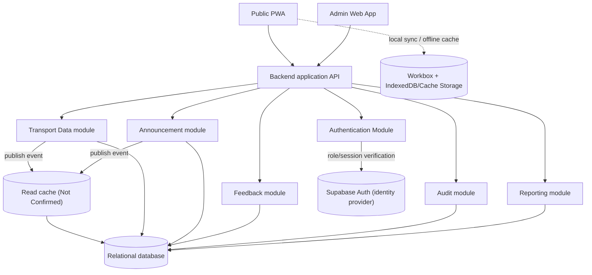

# Architecture: University Transport Information Portal

## 1. Purpose and scope

Students and the public view current departure status, bus/route schedules, and service announcements without logging in. Transport Management and designated administrators create, edit, and publish route, schedule, and announcement data, and review submitted feedback. The portal is intended to become the sole official channel for this information, replacing the existing whatsapp channel.

**Source of truth for product requirements:** Validated_PRD.md.

## 2. Architecturally significant requirements

| ID | Requirement / constraint | Source requirement | Architectural concern |
|---|---|---|---|
| ASR-01 | Published information must be visible/retrievable within 5 seconds (95th percentile) at a baseline of 500 concurrent users / 2,000 scheduled departures. | NFR-01 | Performance and capacity |
| ASR-02 | Confirmed urgent operational changes must be live no later than 1 minute after confirmation. | FR-07, BR-04, BR-16 | Propagation latency |
| ASR-03 | Route, schedule, and assignment edits are saved as drafts and require a separate publish action; students must never see unpublished drafts. | FR-06, FR-14a, BR-24 | Consistency and data model |
| ASR-04 | The client must distinguish and handle three states (stale , offline, and service/data outage) with a 24-hour local cache retention and ~1-minute background sync. | FR-10 to FR-13, NFR-03, BR-10 to BR-12 | Availability and client architecture |
| ASR-05 | Recovery objectives: RTO <= 4 hours, RPO <= 1 hour, verified by recovery testing. | NFR-04 | Reliability and recovery |
| ASR-06 | Successful transport publications must be retained for 30 days with publisher and publication-time attribution. Recovery is limited to previously published transport data (not drafts). | FR-14b, BR-13 | Traceability and data model |
| ASR-07 | Students/public read without authentication; only Transport Management and designated administrators (individual accounts) may edit or publish. | FR-01, C-01, C-02, BR-02, BR-08 | Security and access control |
| ASR-08 | The client must work on mobile, laptop, and desktop, with mobile prioritized. | NFR-02, C-03 | Client architecture |
| ASR-09 | Feedback submissions require a honeypot field, normalized-content duplicate rejection within a trailing 10-minute window, SMTP delivery/retry, and 30-day retention; IP-based limiting is explicitly excluded. | FR-09, BR-18 | Anti-abuse state handling |
| CON-01 | No WhatsApp, GPS/live-tracking, payment, or AI chatbot integration is in scope for this release. | FR-15, BR-25, C-06 | Scope and integration boundary |

## 3. Selected architecture and rationale

**Style:** Modular monolith. A public-facing PWA client, a separate admin web client, one backend application, and a relational database as the system of record. The backend has clear logical module boundaries but is deployed as one application.

**Rationale:** The current scale (500 concurrent users baseline, a small number of privileged roles) does not justify microservices. The added operational complexity (service discovery, distributed transactions, multiple deployment pipelines) would work against ASR-05's recovery objectives, which are simpler to meet with a single system of record. A modular monolith keeps deployment and backup/recovery manageable while still letting each business responsibility (transport data, announcements, feedback, audit, auth) own its own boundaries in code. Reassess if independent scaling or deployment of a specific module becomes a demonstrated requirement.

**Trade-off:** Backend modules will deploy together. Module boundaries must be enforced through code organization and review rather than network isolation. The draft/publish split (ASR-03) and audit trail (ASR-06) add real data-model complexity regardless of deployment style. The complexity is intrinsic to the requirements.

| ASR/driver | Alternatives considered | Trade-offs | Selected decision |
|---|---|---|---|
| ASR-01, ASR-03, ASR-04, CON-01 (overall style) | Microservices, modular monolith, unstructured monolith | Microservices add distributed-transaction, service-discovery, and multi-pipeline overhead not justified at this scale. An unstructured monolith is faster to start but risks coupling that undermines the draft/publish and audit separations | Modular monolith: one deployable backend with enforced internal module boundaries |
| ASR-07, ASR-08 (public/admin separation) | Single unified app with route-based access control. Two separate front-end clients sharing one backend API | A unified app bundles admin code/weight into what students download on mobile and widens the public attack surface. Two clients mean two build pipelines but keep the public bundle lean and the privileged surface isolated | Separate Public PWA and Admin Web App, both calling the same backend API, RBAC enforced at the API, not the client |
| ASR-03, ASR-06 (draft/publish data model) | Single table with a status flag, fully separate draft/published tables, event-sourced model | A bare flag risks a missed filter exposing a draft. Separate tables duplicate schema and need explicit publish-sync logic. Event sourcing fits audit needs but is more complexity than this domain requires | Versioned records per entity (`status` + `version` discriminator), public reads are restricted to published-version rows only |
| ASR-01, ASR-02 (publish propagation) | Client polling only, server push (WebSocket/SSE), backend cache invalidated synchronously on publish | Polling alone is latency-bound by the client's poll interval. Push infrastructure adds persistent-connection overhead not otherwise required. A synchronously invalidated cache makes any subsequent request return fresh data without added infrastructure | Cache layer in front of hot reads, invalidated inside the publish transaction |
| ASR-02 (urgent-change pathway) | Dedicated fast-path/queue for urgent announcements; shared pipeline for all publishing | A dedicated fast path adds complexity for a narrow case; announcements already publish directly (no draft step), so they're already lightweight writes | Urgent and routine announcements share the same publish pipeline; revisit only if contention is observed |
| ASR-04, ASR-08 (offline/caching) | No client-side cache, custom service worker, Workbox | No cache fails the offline requirement outright; Workbox reduces implementation risk | Next.js Public PWA with a Workbox Service Worker, Cache Storage, and IndexedDB; sync runs while the app is open |
| ASR-06 (audit/versioning) | Full edit history, publication-only history | Full history is broader than the approved audit scope | Append-only, transactional transport-publication log with publisher and time; retained for 30 days |
| ASR-07 (authentication/RBAC) | Custom authentication, managed Supabase Auth, self-hosted Supabase Auth | Custom authentication adds security burden; self-hosting retains deployment control | Self-hosted Supabase Auth on the PostgreSQL deployment; the backend owns role mapping and validates active JWTs locally |
| ASR-09 (feedback) | Database-only duplicate check, third-party spam service | A spam service adds an unnecessary dependency | API honeypot validation, database duplicate check, and SMTP delivery with bounded retries |
| ASR-03, ASR-05, ASR-06 (primary data storage) | Single relational database, polyglot persistence (relational + document + separate audit store) | Polyglot persistence multiplies backup/recovery strategies, complicating a unified RTO/RPO | Single relational database as the system of record for all domain data, with point-in-time recovery/replication to meet RTO/RPO |

## 4. Component overview

The diagram only shows logical relationships. Direct database access is allowed only from backend persistence adapters owned by the relevant modules. Cross-module access to another module's tables is prohibited.

## 5. Module responsibilities and boundaries

| Module | Owns | Must not own |
|---|---|---|
| Transport Data | Routes, bus/service identifiers, assignments, schedules, draft and published versions, "current departure" computation | Announcement content; notification/delivery logic |
| Announcement | Announcement and urgent-notice content, direct-publish workflow (no draft step) | Transport schedule data; conflict logic for departures |
| Feedback | Feedback submissions, honeypot validation, normalized duplicate-window detection, SMTP retry, and 30-day retention | IP-based limiting or a status-tracking dashboard |
| Audit | Append-only transport-publication records (publisher and time), 30-day retention, and whole-change-set recovery of previously published data | Edit, announcement-version, and login/logout history; deciding what is published; owning draft content itself |
| Authentication | Self-hosted Supabase Auth integration, backend-owned PostgreSQL role mapping, local JWT validation, and credential lifecycle integration | Credential storage, password hashing, or session persistence; public-user authentication; transport or announcement data; audit-log ownership |
| Reporting | Read-only operational/audit views for administrators (if required beyond the Audit module's own data) | Changing transport data, announcement, or feedback state |

The Transport Data and Announcement modules remain the sole authorities for what is published. The cache layer in Section 4 is a performance aid only and is never a source of truth.

## 6. Important interfaces and contracts

| Contract | Input | Outcome / rule |
|---|---|---|
| PublishTransportData | authenticated privileged user, named change-set ID | Promotes the change set to published versions, writes the publication record, and invalidates relevant cache entries synchronously (supports ASR-01) |
| PublishAnnouncement | authenticated privileged user, announcement content, urgency flag | Publishes directly (no draft step) and invalidates cache synchronously. Must complete within the 1-minute bound for urgent items (ASR-02) |
| GetCurrentDeparture / GetSchedule | route or bus ID, date | Returns only published data; no authentication required (ASR-07) |
| SubmitFeedback | content, honeypot field | Rejects if honeypot is populated or a content-identical submission exists within the last 10 minutes (ASR-09). No IP-based checks |
| GetPublicationHistory / RecoverPublishedChangeSet | change-set ID, date range | Returns transport-publication history for 30 days; recovery targets a whole previously published change set, never a draft (ASR-06) |

## 7. Architectural constraints

1. Preserve the modular monolith unless a reviewed decision changes it.
2. Both the Public PWA and Admin Web App communicate only through the backend API. Neither queries the database directly.
3. A module must not directly access another module's private database tables or internals.
4. The draft/publish split must be enforced at the data layer so that no unpublished draft is ever returned by a public read path (ASR-03, ASR-07).
5. Any cache sitting in front of reads must be invalidated synchronously within the publish transaction, not on a delay, to support ASR-01 and ASR-02.
6. The client must implement local persistence and a sync mechanism capable of distinguishing stale, offline, and outage states, per ASR-04. This logic lives entirely on the client against a locally stored timestamp.
7. Authenticate privileged users through self-hosted Supabase Auth and enforce RBAC in the backend API from a backend-owned role mapping. The backend validates active JWTs locally; active sessions remain authorized until token expiry after deactivation. Public read endpoints remain unauthenticated. Do not build credential storage or session management in the backend.
8. Do not introduce WhatsApp, GPS/live-tracking, payment, AI chatbot integrations, Kafka, Kubernetes, separate deployable microservices, or additional databases without an ASR-based justification and explicit approval (CON-01).
9. Testing for publish-to-visible latency under load, draft/publish isolation, offline/stale/outage client behavior, audit recovery correctness, and feedback duplicate-detection behavior.

## 8. Important Decisions

- **Technology stack:** Python/FastAPI backend; handwritten asynchronous PostgreSQL SQL and migrations; PostgreSQL; separate Next.js Public PWA and Admin Web App; Tailwind CSS with accessible headless components; Workbox; Pytest plus Cypress.
- **Read cache:** A single FastAPI process/worker uses an in-process cache. Any move to multiple workers requires a shared-cache decision.
- **Identity:** Self-hosted Supabase Auth shares the PostgreSQL deployment. Privileged users sign in with email/password; Supabase defaults apply, MFA is not required, and roles are held in a backend-owned PostgreSQL mapping. Only Transport Management manages accounts. The first Transport Management account is manually created through Supabase administration; account deactivation blocks new login but active sessions run to token expiry. Temporary passwords are voluntarily changed.
- **Data lifecycle:** Transport drafts expire after 30 days. Named change sets publish atomically; stale change sets must rebase. Full-day and partial date overrides are supported; partial changes match Route, Bus, and time, and a time change is a remove/add operation. Published data is recoverable as whole change sets for 30 days. Retired records are physically deleted 30 days after retirement.
- **Feedback:** Send to a configured Transport Management mailbox using backend SMTP. Normalize case, leading/trailing whitespace, and repeated internal whitespace for duplicate detection. Retry failed mail after 1, 5, and 30 minutes; retain feedback for 30 days. Immediate SMTP failure displays an error; later successful retry is not reported. A resubmission while retry is pending receives a neutral “already received” message.
- **Hosting/infrastructure provider:** Deliberately deferred. Local development services are approved; a production deployment and RTO/RPO verification remain release prerequisites.

## 9. Architecture review checklist

- Does each ASR have an architectural response?
- Are responsibilities and data ownership clear?
- Are cross-module interactions made through explicit contracts?
- Can a published-data cache ever serve stale or draft content past the publish transaction?
- Can a client correctly distinguish stale, offline, and outage states without server round-trips?
- Can recovery ever restore a draft (rather than a previously-published version) by mistake?
- Has the implementation added complexity (e.g., push infrastructure, polyglot persistence, microservices) without an ASR-based justification?

Any accepted change to a major architectural decision should update this document and record its rationale.
