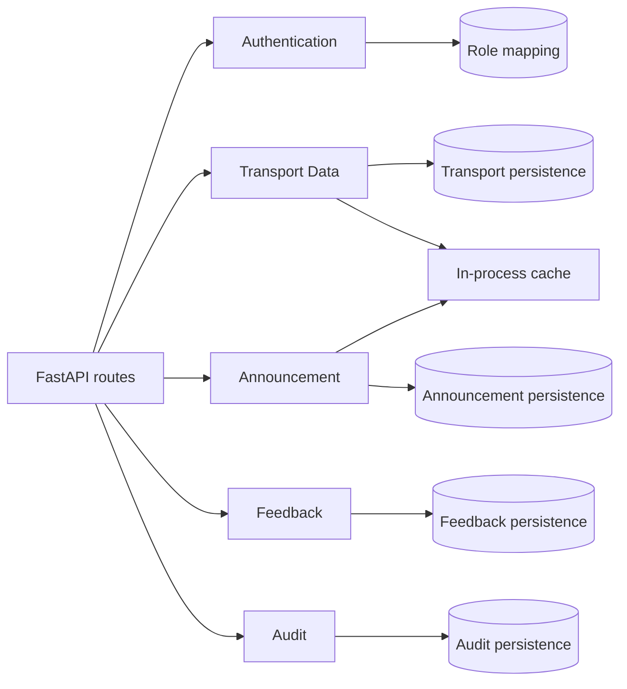

# Component Design

## System components

| Component | Responsibility | Does not do |
|---|---|---|
| Public PWA | Render published transport, announcements, feedback, cache state, online-only banners | Authenticate public users or access database |
| Admin Web App | Privileged draft/publication, announcement/banner, recovery, account-management forms | Make authorization decisions locally |
| FastAPI API | HTTP validation, authentication boundary, module routing, OpenAPI/errors | Store browser cache state |
| Authentication | Validate active Supabase JWTs locally and resolve backend role mappings | Store credentials or sessions |
| Transport Data | Change sets, PKT schedules, validation, published projections | Announcement lifecycle/audit retention |
| Announcement | Direct announcements and independent urgent banners | Transport draft/publication flow |
| Feedback | Honeypot, duplicate check, SMTP delivery/retry, retention | IP limiting/status dashboard |
| Audit | Publication records and recovery eligible published sets | Draft content/general edit history |
| Read cache | Single-worker hot-read acceleration, synchronous publish invalidation | System-of-record persistence |

## Public PWA composition

```text
App shell
├─ SyncStatus (PKT timestamp + fresh/stale/offline/outage)
├─ UrgentBannerList (network only)
├─ CurrentDeparturesPanel
│  └─ DepartureCard / NoFurtherDeparturesState
├─ DailyScheduleTable
├─ AnnouncementFeed
└─ FeedbackForm
```

`PublicDataRepository` owns fetch/snapshot persistence using Workbox, Cache Storage, and IndexedDB. It saves a successful synchronization timestamp, attempts refresh every minute while open plus reconnection/manual refresh, and never advances the timestamp on failure. `ConnectivityState` differentiates no network from service/data failure.

## Admin composition and backend direction

```text
Admin shell
├─ AuthSession / RoleGuard (UI convenience; backend is authoritative)
├─ ChangeSetWorkspace → Route/Bus/Assignment/Schedule editors + Publish panel
├─ PublicationHistoryAndRecovery
├─ AnnouncementEditor + UrgentBannerLifecyclePanel
└─ AccountManagement (Transport Management only)
```



Modules expose application services/DTOs rather than querying another module’s private tables. Transport publishes through an Audit interface within its transaction boundary; Audit never decides what is published.

## Key interactions

**Publish transport:** validate JWT/role; verify draft expiry/base and warnings; atomically promote snapshot/current pointer, retire the old pointer, write one publication record, and invalidate cache before success returns.

**Slice 2 delivery:** The Transport Data change-set application service owns
draft creation/read/update, validation, stale-baseline rejection/rebase,
explicit warning confirmation, recovery invocation, and published-cache
invalidation. The PostgreSQL adapter updates a draft snapshot only at its
expected version, moves the published pointer, retires its predecessor, and
calls Audit’s transaction-joining publication interface. Audit owns the
publication record and recovery eligibility window. The sole FastAPI worker
runs hourly draft-expiry, expired-publication-record, and retired-record
cleanup; cleanup failure never stops serving public reads.

**Feedback:** reject populated honeypot; check normalized 10-minute duplicate window; persist and attempt SMTP; on initial failure retain, show error, and schedule only 1-, 5-, and 30-minute retries.

**Urgent operations:** direct publication creates announcement; urgent flow also creates independent banner. Announcement expiry never ends banner visibility; explicit remove/resolve does.
