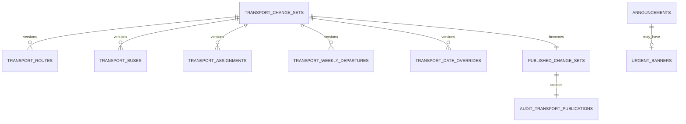

# Data Model and Schema Design

## Status

This implemented PostgreSQL model is based on migrations `0001` through
`0008`. Each module accesses only its own tables; cross-module use is through
documented services. All business-date calculations use PKT (`Asia/Karachi`);
persisted instants use `timestamptz`.

## Ownership map

| Module | Tables owned | Lifecycle |
|---|---|---|
| Authentication | `authentication_role_mappings` | One mapped role per Supabase user; deactivation blocks new login. |
| Transport Data | `transport_change_sets`, versioned `transport_routes`, `transport_buses`, `transport_assignments`, `transport_weekly_departures`, `transport_date_overrides`, `published_change_sets` | One permanent working draft; retired published records delete at 30 days. |
| Audit | `audit_transport_publications` | Publication actor/time only; 30 days. |
| Announcement | `announcements`, `urgent_banners` | Removed/expired announcements retained 30 days; banner lifecycle independent. |
| Feedback | `feedback_submissions` | Normalized duplicate check, delivery retry state, 30 days. |
| Reporting | no owned write tables | Read-only module interfaces only. |

## Core tables

`authentication_role_mappings`: `supabase_user_id uuid primary key`, `role` constrained to `transport_management`/`designated_administrator`, `is_active`, `created_at`, `deactivated_at`. Supabase owns credentials and sessions, so neither passwords nor tokens belong here.

`transport_change_sets`: `id`, unique `name`, `status` (`draft`, `published`, `retired`, `expired`), `version`, `base_published_change_set_id`, `created_at`, `updated_at`, `expires_at`, and `retired_at`. Exactly one row has `status = 'draft'`; it is the permanent working draft and its expiry is never processed. Publishing copies its snapshot into a new published row and advances its base pointer. Every versioned transport record has `id`, `change_set_id`, `version`, and `status`; public queries load only the current `published_change_sets` record and `status = 'published'` rows.

| Table | Domain columns | Key constraint |
|---|---|---|
| `transport_routes` | `route_code`, `origin`, `destination`, `direction` (`RETURN` or `PICK-UP`) | unique `(change_set_id, route_code)` |
| `transport_buses` | `bus_identifier` | unique `(change_set_id, bus_identifier)` |
| `transport_assignments` | `route_code`, `bus_identifier` | unique `(change_set_id, route_code, bus_identifier)` |
| `transport_weekly_departures` | ISO `weekday` (1–7), `local_departure_time`, `route_code`, legacy `bus_identifier` | one row per change set/weekday/route/time; the application ignores the legacy bus column and expands to current Route-to-bus assignments |
| `transport_date_overrides` | `service_date`, `is_full_day_no_service`, operation, route/bus/time references | partial match is Route + Bus + time; time changes are remove/add |
| `published_change_sets` | `change_set_id`, `published_at`, `is_current` | exactly one current pointer |

The application validates request shape before saving. A route with no recurring schedule entry is saveable but produces the only publish warning and needs explicit confirmation. Schedule rows do not select a bus: each one applies to all buses assigned to its Route. Later published sets take precedence.

`audit_transport_publications`: `id`, `change_set_id`, `publisher_supabase_user_id`, `published_at`, and `expires_at`. It deliberately excludes edits, login/logout, announcements, and announcement version history. Recovery creates a new change set from an eligible whole published snapshot.

`announcements`: `id`, `title`, optional `content`, `published_at`, `expires_at`, `removed_at`, and `updated_at`; no version table. It stores no operational-change or confirmation state. `urgent_banners`: `id`, `announcement_id`, `title`, `content`, `created_at`, `removed_at`, and `resolved_at`. Publicly active requires both end fields null; announcement expiry never changes this.

`feedback_submissions`: `id`, optional `name`/`contact`, `content`, `normalized_content`, `received_at`, nullable `delivered_at`, `retry_count` (0--3), and nullable `next_retry_at`. Index `(normalized_content, received_at DESC)` supports 10-minute duplicate checks; a partial `next_retry_at` index supports retries. No IP or status-tracking field exists.

## Transaction and lifecycle invariants

1. Publication writes new published versions and pointer, retires the prior pointer, and writes exactly one publication record in one PostgreSQL transaction. The service invalidates the in-process cache synchronously after that transaction succeeds and before the request returns.
2. Public reads select only active published records; drafts cannot appear.
3. Recovery uses only a nonexpired whole published snapshot and normal publish rules; drafts and announcements are never recovered.
4. PKT date conversion precedes weekly/override resolution. Weekly rows use weekday 1–7 and expand to Route assignments. Full-day no-service wins; partial overrides match Route, Bus, time.
5. Retention jobs delete only records at their approved 30-day boundaries.
