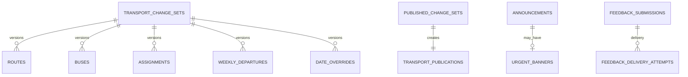

# Data Model and Schema Design

## Status
Proposed PostgreSQL data model; a design artifact, not a migration. Modules access only their owned tables. Business-date calculation uses PKT and persisted instants use `timestamptz`.

| Module | Owned tables | Lifecycle |
|---|---|---|
| Authentication | `authentication_role_mappings` | Supabase user ID, role, active/deactivation fields. |
| Transport Data | `transport_change_sets`, versioned routes, buses, assignments, weekly departures, date overrides, published pointers | Draft/retired-record expiry at 30 days. |
| Audit | `transport_publications`, recovery metadata | Publisher/time only; 30 days. |
| Announcement | `announcements`, `urgent_banners` | Removed/expired announcements retained 30 days; independent banner lifecycle. |
| Feedback | `feedback_submissions`, `feedback_delivery_attempts` | Normalized-content duplicate and retry state; 30 days. |

Transport change sets use `draft`, `published`, `retired`, and `expired` state plus a published-base pointer for stale detection. Version records carry `change_set_id`, `version`, and state; public reads join only the current published pointer. Weekly departures are unique by change set, weekday, route, bus, and local departure time. Full-day overrides win; partial overrides match Route, Bus, and time.

Announcements have publication/expiry/removal timestamps with no version table. A banner is public only until explicit remove or resolve, independent of its linked announcement. Feedback stores normalized content, delivery state, next retry, and attempt records; index normalized content/time for the 10-minute window. No IP or feedback-status-tracking data is modeled.

Publication atomically promotes the snapshot, changes pointer, retires prior data, creates exactly one publisher/time audit record, and invalidates the in-process cache. Recovery starts a new change set from an eligible whole published snapshot only.
