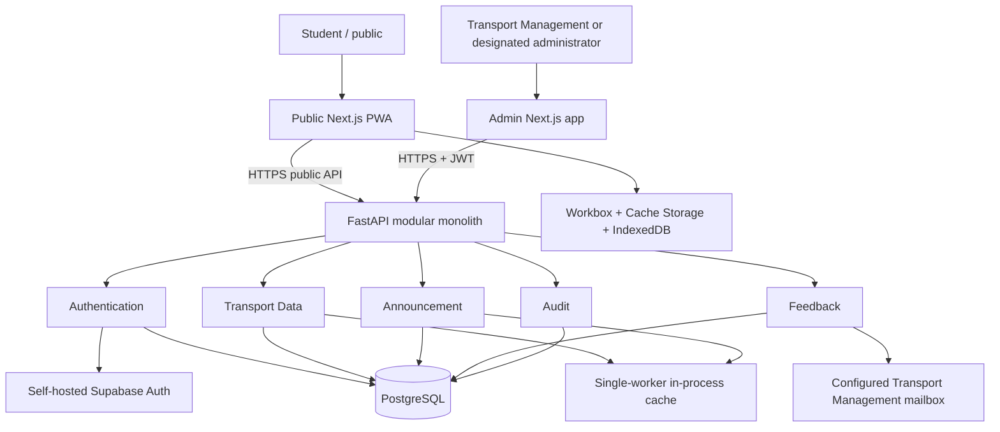
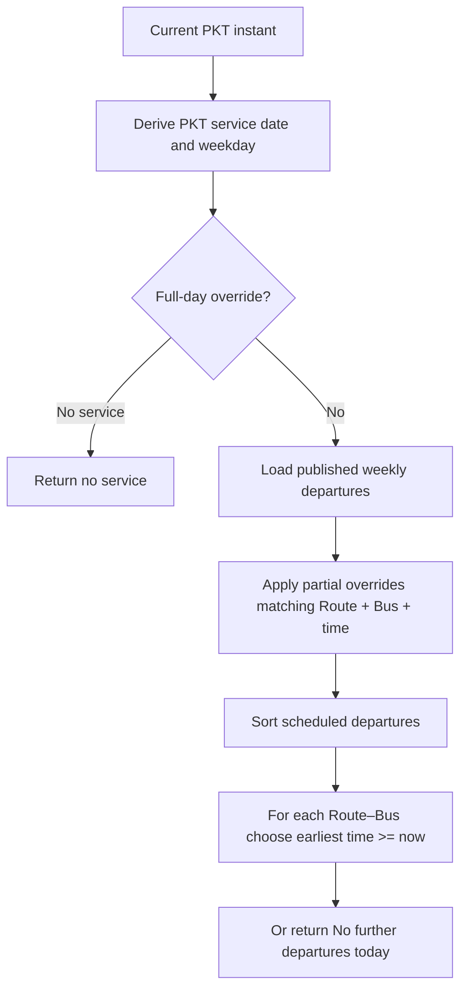

# System Diagrams

## Container view



Only backend persistence adapters access PostgreSQL. The cache and browser storage are not systems of record.

## Atomic transport publication

```mermaid
sequenceDiagram
  participant A as Admin app
  participant API as FastAPI / Transport Data
  participant DB as PostgreSQL
  participant AUD as Audit module
  participant C as Read cache
  participant P as Public PWA
  A->>API: Publish(change set, expected base, publish_anyway)
  API->>DB: Verify role, draft state, current base
  alt stale base
    DB-->>API: conflict
    API-->>A: 409; rebase required
  else eligible
    API->>DB: Begin transaction; promote snapshot/current pointer
    API->>AUD: Record publisher + publication time
    AUD->>DB: Insert publication event
    API->>C: Invalidate relevant reads synchronously
    API->>DB: Commit
    API-->>A: 201 published
    P->>API: Read published schedule/current departures
    API-->>P: new published view only
  end
```

## Schedule resolution in PKT



## PWA freshness state

```mermaid
stateDiagram-v2
  [*] --> Loading
  Loading --> Fresh: fetch succeeds; save snapshot/time
  Loading --> Unavailable: no snapshot and fetch fails
  Fresh --> Fresh: successful scheduled/reconnect/manual refresh
  Fresh --> Stale: age > 5 min
  Fresh --> Offline: browser offline; snapshot age <= 24h
  Fresh --> Outage: online, fetch fails; snapshot age <= 24h
  Stale --> Fresh: fetch succeeds
  Stale --> Offline: browser offline
  Stale --> Outage: online, fetch fails
  Offline --> Fresh: reconnect + fetch succeeds
  Outage --> Fresh: fetch succeeds
  Offline --> Unavailable: snapshot age > 24h
  Outage --> Unavailable: snapshot age > 24h
```



Fresh/stale is an age property of the saved successful synchronization timestamp. Offline/outage is a connectivity property; either can coexist conceptually with stale content. Active urgent banners bypass local persistence and appear only after an online fetch.
