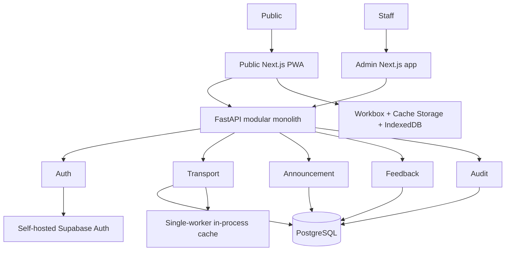
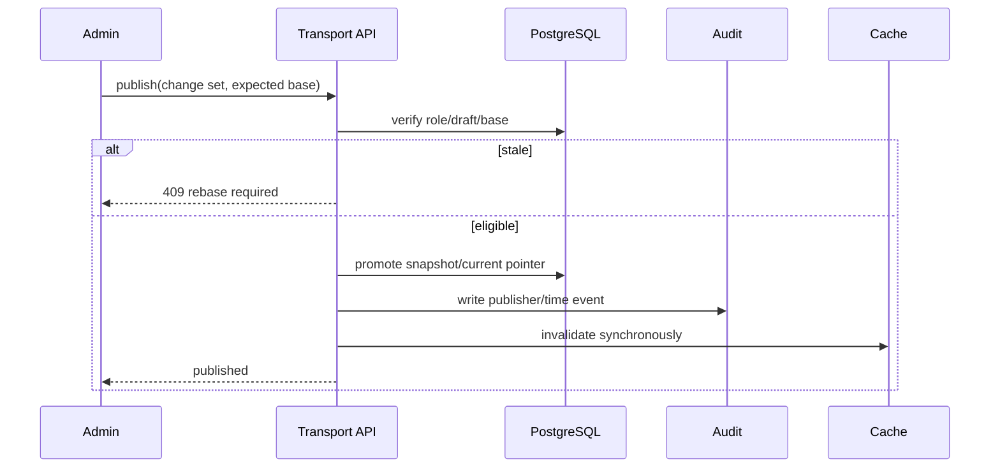
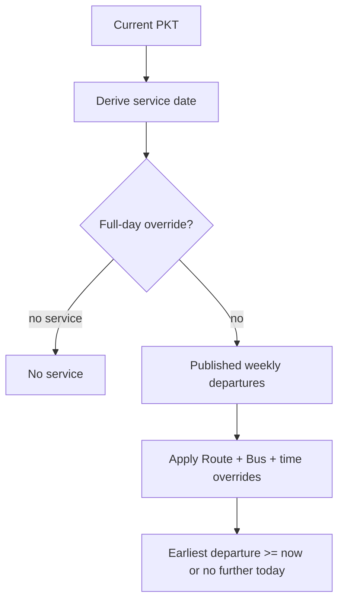

# System Diagrams

## Container view

## Publication sequence

## PKT schedule and PWA state

Freshness is based only on the saved successful synchronization timestamp (fresh through 5 minutes). Offline and service outage are distinct connectivity states. Cached core data/announcements expire at 24 hours; active urgent banners are never cached.
